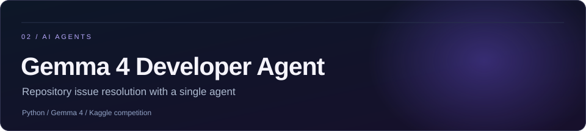

  

  <a href="https://github.com/aiaryskaliden"><b>← Back to profile</b></a>
  &nbsp; / &nbsp;
  <a href="#guardianvoice--team-project"><b>GuardianVoice</b></a>
  &nbsp; / &nbsp;
  <a href="#gemma-4-developer-agent--kaggle-competition"><b>Gemma 4 Agent</b></a>
  &nbsp; / &nbsp;
  <a href="#titanic--historical-record-linkage"><b>Titanic</b></a>
  &nbsp; / &nbsp;
  <a href="https://www.kaggle.com/kalidenaiarys"><b>Kaggle</b></a>

A selection of my personal and team projects. Here you'll find what we built, the tools behind it, and what the results mean.

---

### GuardianVoice / Team project

**A working React web application combining personal-safety tools and accessible interaction.**

I co-developed **GuardianVoice** with a teammate, working together to build its user experience and bring several safety and accessibility features into one application. The implemented features include:

- **Voice-triggered SOS:** a customizable spoken phrase opens the SOS workflow. A countdown leads to an SMS-app handoff with an optional geolocation link; delivery is not automatically confirmed.
- **Interactive help map:** a Leaflet/OpenStreetMap map shows the user's location (with permission), preconfigured support-center listings and optional marked risk areas.
- **AI Vision:** with camera permission, the application sends snapshots to a hosted AI service and can read scene descriptions aloud.
- **Safety-information assistant:** a chat interface for questions about personal safety, available support and relevant rights.
- **Accessibility features:** a visual/vibration option and keyboard-focus improvements.

`React` &nbsp; `Vite` &nbsp; `Leaflet` &nbsp; `JavaScript` &nbsp; `CSS` &nbsp; `Accessibility`

I worked on the UI and visual design, the map, and testing with my teammate. I also improved keyboard focus and reduced-motion styling in [PR #1](https://github.com/zoga228/infomatrix_2026_GuardianVoice/pull/1), which was merged into the main branch.

**Project status:** The original repository describes GuardianVoice as a prototype. The application contains working frontend features, but its emergency workflows and AI navigation suggestions have not been independently validated. Support-center listings and map risk areas are preconfigured, and some AI functions require external services.

**Explore** &nbsp; [Team repository](https://github.com/zoga228/infomatrix_2026_GuardianVoice) &nbsp; / &nbsp; [Merged accessibility PR](https://github.com/zoga228/infomatrix_2026_GuardianVoice/pull/1) &nbsp; / &nbsp; [Project documentation](https://github.com/zoga228/infomatrix_2026_GuardianVoice#readme)

---

### Gemma 4 Developer Agent / Kaggle competition

**A focused coding-agent submission using the pretrained Gemma 4 model.**

I built and submitted an agent configuration for the [Google — The Gemma 4 Developer Agent Competition](https://www.kaggle.com/competitions/gemma-4-developer-agent). Its intended workflow is straightforward: understand a repository issue, find the relevant code, produce a small patch, verify the changes, and hand off the result.

I designed the agent's instructions and configuration, and built a reproducible submission package. The submission was accepted by Kaggle. This work focuses on agent orchestration rather than training or fine-tuning a model.

`Python` &nbsp; `Gemma 4` &nbsp; `LLM agents` &nbsp; `Prompt engineering`

The code and executed Notebook remain in a **private repository** while the competition's code-sharing restrictions apply.

**Explore** &nbsp; [Competition](https://www.kaggle.com/competitions/gemma-4-developer-agent) &nbsp; / &nbsp; [Kaggle profile](https://www.kaggle.com/kalidenaiarys)

---

### Titanic / Historical Record Linkage

**What happens when two datasets contain records of the same people?**

A reproducible Python project matching Kaggle Titanic passenger records with the Vanderbilt Titanic3 historical dataset. The workflow normalizes identity fields, validates one-to-one matches, and outputs verification artifacts.

`Python` &nbsp; `pandas` &nbsp; `Record linkage` &nbsp; `Data validation`

**Recorded checks:** 891 training records and 418 test records linked, with no unmatched or ambiguous identities in the documented run. These are **record matching results**, not machine-learning accuracy: the approach uses published historical outcomes and does not train a predictive model.

**Explore** &nbsp; [Source and methods](https://github.com/aiaryskaliden/titanic-historical-record-linkage) &nbsp; / &nbsp; [Kaggle notebook](https://www.kaggle.com/code/kalidenaiarys/titanic-historical-record-linkage-1309-verified) &nbsp; / &nbsp; [Verification details](https://github.com/aiaryskaliden/titanic-historical-record-linkage#results-and-verification)

---

  <a href="https://github.com/aiaryskaliden"><b>Profile</b></a>
  &nbsp; · &nbsp;
  <a href="https://github.com/aiaryskaliden?tab=repositories"><b>Repositories</b></a>
  &nbsp; · &nbsp;
  <a href="https://www.kaggle.com/kalidenaiarys"><b>Kaggle</b></a>

Aiarys Kaliden · Building, learning, documenting.

