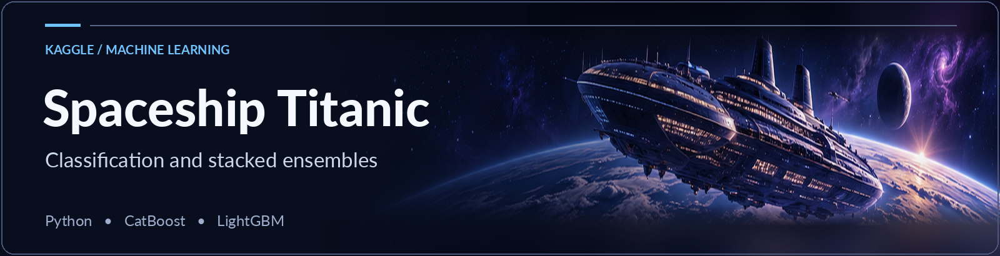
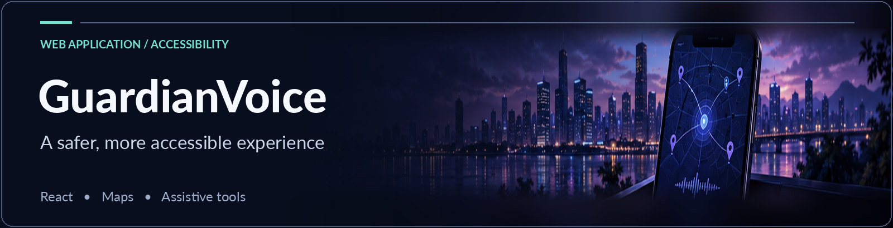
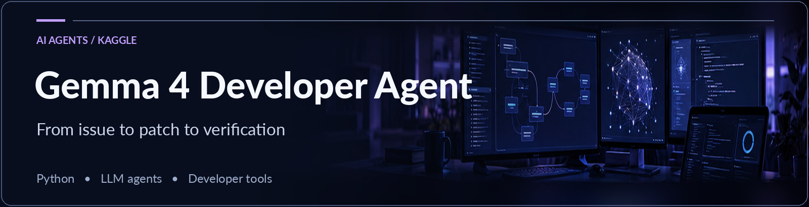
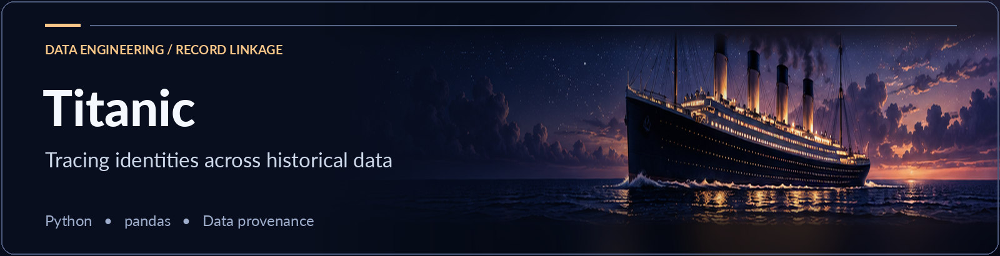
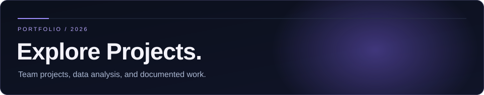

  

  <a href="#selected-projects"><b>Explore projects</b></a>
  &nbsp; · &nbsp;
  <a href="./PROJECTS.md"><b>Projects</b></a>
  &nbsp; · &nbsp;
  <a href="https://www.kaggle.com/kalidenaiarys"><b>Kaggle</b></a>
  &nbsp; · &nbsp;
  <a href="mailto:aiariskaliden@gmail.com"><b>Contact</b></a>

### About me

I'm a student from Kazakhstan, interested in programming, mathematics and machine learning. I like turning ideas into practical projects, exploring data, and building things together with other developers.

**Tools I use** &nbsp; `Python` &nbsp; `pandas` &nbsp; `scikit-learn` &nbsp; `JavaScript` &nbsp; `React`

### Selected projects

**[Spaceship Titanic — Classification Ensemble](https://github.com/aiaryskaliden/Spaceship-Titanic67)** &nbsp;·&nbsp; *Kaggle competition*

I explored feature engineering, group-aware validation and ensemble learning for Kaggle's Spaceship Titanic classification challenge. The workflow combines CatBoost and LightGBM experiments with stacking over previously published TabPFN predictions.

Recorded Kaggle public accuracy: **0.82534** (October 2026).

`Python` &nbsp; `pandas` &nbsp; `CatBoost` &nbsp; `LightGBM` &nbsp; `scikit-learn`

[Project and notebook](https://github.com/aiaryskaliden/Spaceship-Titanic67) &nbsp; / &nbsp; [Competition](https://www.kaggle.com/competitions/spaceship-titanic) &nbsp; / &nbsp; [Methods and attribution](https://github.com/aiaryskaliden/Spaceship-Titanic67/blob/main/ATTRIBUTION.md)

*Project repository is currently private; its source links will work for visitors after publication.*

---

**[GuardianVoice](https://github.com/zoga228/infomatrix_2026_GuardianVoice)** &nbsp;·&nbsp; *Team project*

I co-developed **GuardianVoice** with a teammate, building a working React web application focused on personal safety and accessibility in Kazakhstan. We brought together **voice-triggered SOS**, location sharing through the phone's SMS app, an interactive map of support resources, **AI-powered camera descriptions with speech output**, and a safety-information chat assistant.

I worked on the interface design, the map, and testing alongside my teammate. I also added keyboard focus and reduced-motion styles in [PR #1](https://github.com/zoga228/infomatrix_2026_GuardianVoice/pull/1).

`React` &nbsp; `Vite` &nbsp; `Leaflet` &nbsp; `JavaScript` &nbsp; `CSS`

*The project's original README classifies it as a prototype. Safety-related functions have not been independently validated.*

[View GuardianVoice](https://github.com/zoga228/infomatrix_2026_GuardianVoice) &nbsp; / &nbsp; [Merged accessibility PR](https://github.com/zoga228/infomatrix_2026_GuardianVoice/pull/1)

---

**Gemma 4 Developer Agent** &nbsp;·&nbsp; *Kaggle competition*

Built a single-agent coding workflow for the Google Gemma 4 Developer Agent Competition. The agent is configured to inspect repository issues, prepare focused patches, and verify changes before submission.

`Python` &nbsp; `Gemma 4` &nbsp; `LLM Agents` &nbsp; `Agent Configuration`

[Kaggle competition](https://www.kaggle.com/competitions/gemma-4-developer-agent)

*Source repository is private while the competition's code-sharing rules apply.*

---

**[Titanic — Historical Record Linkage](https://github.com/aiaryskaliden/titanic-historical-record-linkage)** &nbsp;·&nbsp; *Data analysis project*

A Python project exploring how records in two Titanic datasets can be matched and verified. It investigates dataset provenance, reproducibility and data leakage — not the accuracy of a trained survival-prediction model.

[Source and methodology](https://github.com/aiaryskaliden/titanic-historical-record-linkage) &nbsp; / &nbsp; [Kaggle notebook](https://www.kaggle.com/code/kalidenaiarys/titanic-historical-record-linkage-1309-verified)

### More work

  <a href="./PROJECTS.md">All projects</a>
  &nbsp; / &nbsp;
  <a href="https://github.com/aiaryskaliden?tab=repositories">Repositories</a>
  &nbsp; / &nbsp;
  <a href="https://www.kaggle.com/kalidenaiarys">Kaggle</a>

---

Aiarys Kaliden · Building, learning, documenting.
