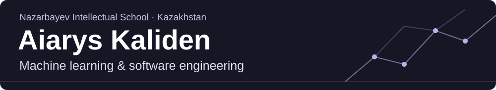
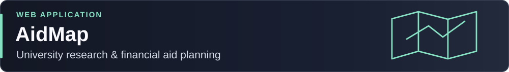
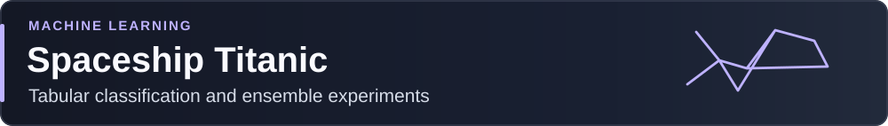
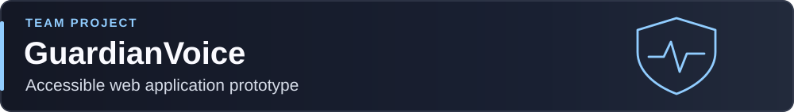
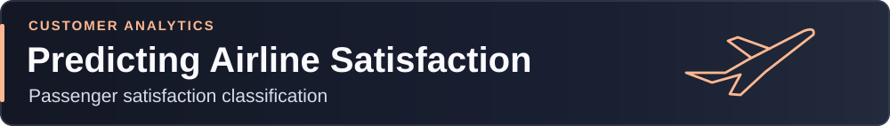
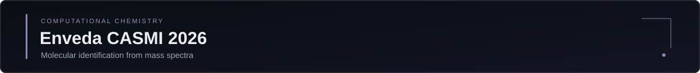
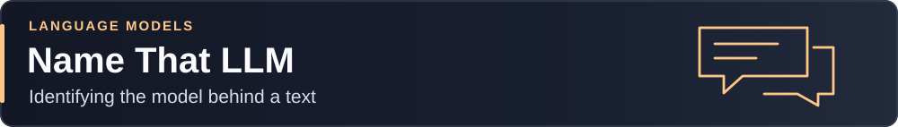
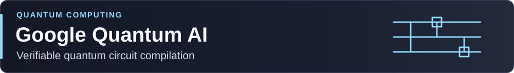
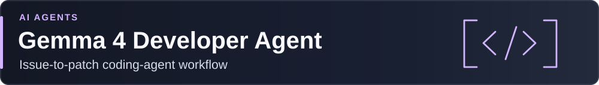
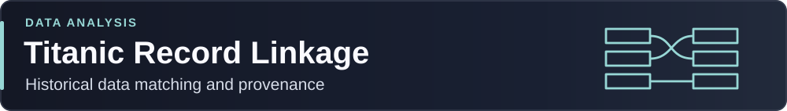

[Selected projects](#selected-projects) · [Kaggle results](#kaggle-results) · [All projects](./PROJECTS.md) · [Contact](mailto:aiariskaliden@gmail.com)

I'm a Grade 12 student in Kazakhstan. I build tools for university applicants and study how machine-learning models perform on real datasets. At the **2026 International Fizmat Artificial Intelligence Olympiad**, my team won **silver, placing 5th among 47 finalist teams**.

## Selected projects

### AidMap
I built a university and financial-aid explorer covering **34 university profiles**. Applicants can compare costs and scholarship terms, follow each claim to its source and keep their application plans on their own device.

[Open AidMap](https://aidmap-aiaryskaliden.vercel.app/) · [Source code and data methodology](https://github.com/aiaryskaliden/Aidmap)

### Spaceship Titanic
I engineered passenger-group and cabin features, evaluated CatBoost and LightGBM using group-aware validation, and tested stacking with published TabPFN predictions. My ensemble reached **0.82534 public accuracy** and ranked **15th** on October 19, 2026.

[Read the experiment notes](./PROJECTS.md#spaceship-titanic--machine-learning) · [Competition](https://www.kaggle.com/competitions/spaceship-titanic)

### GuardianVoice
I co-developed a React accessibility prototype. My merged changes covered the interactive Leaflet map, keyboard focus, reduced-motion support and interface tests.

[Review my merged pull request](https://github.com/zoga228/infomatrix_2026_GuardianVoice/pull/1) · [Team repository](https://github.com/zoga228/infomatrix_2026_GuardianVoice)

## Kaggle results

| Competition | Best recorded score | Leaderboard position |
| :--- | ---: | :--- |
| [Enveda CASMI](https://www.kaggle.com/competitions/enveda-CASMI26-molecule-id-mass-spectra) | **0.487** | 109 / 5,142 teams (Nov. 12, 2026) |
| [Spaceship Titanic](https://www.kaggle.com/competitions/spaceship-titanic) | **0.82534** | 56 / 2,030 teams (Nov. 12, 2026) |
| [Predicting Airline Satisfaction](https://www.kaggle.com/competitions/playground-series-s6e10) | — | **213 / 3,734 teams** (final) |
| [Name That LLM](https://www.kaggle.com/competitions/name-that-llm) | **0.682** | 403 / 5,535 teams (Nov. 12, 2026) |
| [Google Quantum AI](https://www.kaggle.com/competitions/google-verifiable-quantum-circuit-compilation) | **25.09052** | 1,060 / 2,856 teams (Nov. 12, 2026) |
| [Gemma 4 Developer Agent](https://www.kaggle.com/competitions/gemma-4-developer-agent) | **0.17** | 2,234 / 5,427 teams (Nov. 12, 2026) |

### Competition work

Competed individually in tabular classification of passenger satisfaction. Finished **213th of 3,734 teams (top 5.7%)**.

---

Compared notebook runs that inferred molecular structures from mass spectra. Improved my public score from **0.481 to 0.487** (**109th of 5,142 teams**, top 2.1%).

---

Evaluated successive model-attribution notebooks against Kaggle’s public benchmark. Raised my score from **0.669 to 0.682** (**403rd of 5,535 teams**, top 7.3%).

---

Compared candidate circuits, checked validity and evaluated resource use. Raised my personal best from **24.94087 to 25.09052** (**1,060th of 2,856 teams**).

**Gemma 4 Developer Agent.** I configured a pretrained agent to inspect repositories, propose focused patches and check them against tests. [Project notes](./PROJECTS.md#gemma-4-developer-agent--kaggle-competition)

[Kaggle profile](https://www.kaggle.com/kalidenaiarys) · [Competition records and notebooks](./KAGGLE.md)

## Data analysis

**Titanic historical record linkage.** I built reproducible Python checks to match **1,309 passenger records** across historical datasets and documented how known outcomes can leak into a survival-prediction benchmark.

[Source and methodology](https://github.com/aiaryskaliden/titanic-historical-record-linkage) · [Kaggle notebook](https://www.kaggle.com/code/kalidenaiarys/titanic-historical-record-linkage-1309-verified)
