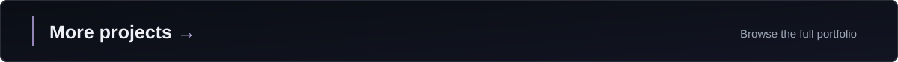

  

  <a href="#selected-projects"><b>Explore projects</b></a>
  &nbsp; · &nbsp;
  <a href="./PROJECTS.md"><b>Projects</b></a>
  &nbsp; · &nbsp;
  <a href="https://www.kaggle.com/kalidenaiarys"><b>Kaggle</b></a>
  &nbsp; · &nbsp;
  <a href="mailto:aiariskaliden@gmail.com"><b>Contact</b></a>

### About me

I'm a Grade 12 student at Nazarbayev Intellectual School in Kazakhstan, focused on AI, computer science, and building useful software. I won a **team silver medal at FAIO 2026** (5th of 47 finalist teams). My work ranges from a source-linked university-planning application to Kaggle experiments and reproducible data analysis.

**Tools I use** &nbsp; `Python` &nbsp; `pandas` &nbsp; `scikit-learn` &nbsp; `JavaScript` &nbsp; `React`

### Selected projects

**[AidMap](https://aidmap-aiaryskaliden.vercel.app/)** &nbsp;·&nbsp; *Web application*

A source-linked, local-first project covering **34 university research profiles**, with admission and scholarship comparisons, cost scenarios, and a private application-planning workspace.

[Live website](https://aidmap-aiaryskaliden.vercel.app/) &nbsp; / &nbsp; [Project overview](https://github.com/aiaryskaliden/Aidmap) &nbsp; / &nbsp; [Details](./PROJECTS.md#aidmap--university-discovery--financial-aid)

*The public Aidmap repository currently contains the project overview, not the deployed site's source code. Confirm admission and aid information with official university sources.*

---

**Spaceship Titanic — Classification Ensemble** &nbsp;·&nbsp; *Kaggle competition*

Feature engineering, group-aware validation, CatBoost/LightGBM experiments, and stacking with properly attributed published TabPFN predictions.

**Recorded Kaggle public score: 0.82534; #15 on the public leaderboard on October 19, 2026** (dated snapshot; rankings change).

`Python` &nbsp; `pandas` &nbsp; `CatBoost` &nbsp; `LightGBM` &nbsp; `scikit-learn`

[Project details](./PROJECTS.md#spaceship-titanic--machine-learning) &nbsp; / &nbsp; [Competition](https://www.kaggle.com/competitions/spaceship-titanic)

*Source repository is currently private.*

---

**[GuardianVoice](https://github.com/zoga228/infomatrix_2026_GuardianVoice)** &nbsp;·&nbsp; *Team project*

A React prototype for safety information and accessibility. I worked on the interface, interactive map and testing, including keyboard-focus and reduced-motion improvements.

`React` &nbsp; `Vite` &nbsp; `Leaflet` &nbsp; `JavaScript`

[Team repository](https://github.com/zoga228/infomatrix_2026_GuardianVoice) &nbsp; / &nbsp; [Merged PR](https://github.com/zoga228/infomatrix_2026_GuardianVoice/pull/1)

*The original project is a prototype; emergency features have not been independently validated.*

---

**Gemma 4 Developer Agent** &nbsp;·&nbsp; *Kaggle competition*

A single-agent workflow configured to understand repository issues, prepare focused patches, and check changes.

`Python` &nbsp; `Gemma 4` &nbsp; `LLM agents`

[Project details](./PROJECTS.md#gemma-4-developer-agent--kaggle-competition) &nbsp; / &nbsp; [Competition](https://www.kaggle.com/competitions/gemma-4-developer-agent)

*Source repository is private while competition sharing restrictions apply.*

---

**[Titanic — Historical Record Linkage](https://github.com/aiaryskaliden/titanic-historical-record-linkage)** &nbsp;·&nbsp; *Data analysis*

Reproducible Python matching between Titanic datasets, with checks for data provenance and leakage. This is not a survival-prediction model.

[Source and methodology](https://github.com/aiaryskaliden/titanic-historical-record-linkage) &nbsp; / &nbsp; [Kaggle notebook](https://www.kaggle.com/code/kalidenaiarys/titanic-historical-record-linkage-1309-verified)

### Kaggle — recent results and notebooks

- **Predicting Airline Satisfaction (2026):** ranked **213rd of 3,734 teams** in the completed Kaggle Playground competition (profile snapshot: November 11, 2026).
- **Google Quantum AI — Verifiable Quantum Circuit Compilation:** experimented with circuit optimization, validation, and submission packaging. [Public notebook](https://www.kaggle.com/code/kalidenaiarys/24-80179-public-lb-quantum-circuit-compilation). No unverified rank or medal claimed.
- **Five public notebooks:** including Spaceship Titanic, quantum circuits, the historical Titanic record-linkage study, PLE Field Lab, and CarbonGlobe.

[Selected Kaggle work and evidence notes](./KAGGLE.md) &nbsp; / &nbsp; [Kaggle profile](https://www.kaggle.com/kalidenaiarys)

---

### More work

  <a href="./PROJECTS.md">All projects</a>
  &nbsp; / &nbsp;
  <a href="https://github.com/aiaryskaliden?tab=repositories">Repositories</a>
  &nbsp; / &nbsp;
  <a href="https://www.kaggle.com/kalidenaiarys">Kaggle</a>

---

Aiarys Kaliden · Building, learning, documenting.
