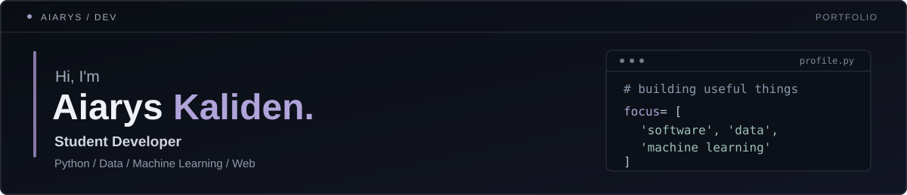
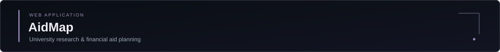
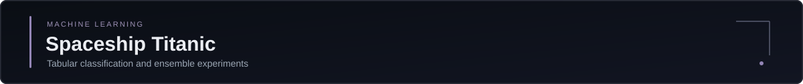
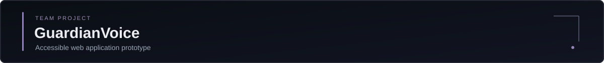
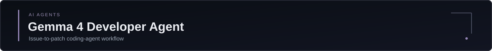
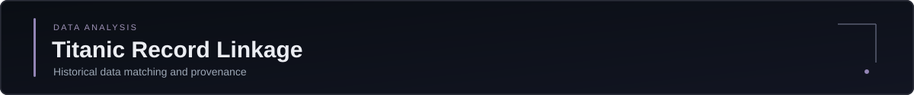
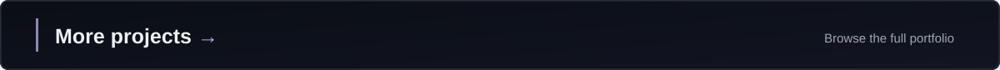

  

  <a href="#selected-projects"><b>Explore projects</b></a>
  &nbsp; · &nbsp;
  <a href="./PROJECTS.md"><b>Projects</b></a>
  &nbsp; · &nbsp;
  <a href="https://www.kaggle.com/kalidenaiarys"><b>Kaggle</b></a>
  &nbsp; · &nbsp;
  <a href="mailto:aiariskaliden@gmail.com"><b>Contact</b></a>

### About me

I'm a student from Kazakhstan, interested in programming, mathematics and machine learning. I enjoy turning ideas into useful projects, exploring data, and writing code I can explain and improve.

**Tools I use** &nbsp; `Python` &nbsp; `pandas` &nbsp; `scikit-learn` &nbsp; `JavaScript` &nbsp; `React`

### Selected projects

**[AidMap](https://aidmap-aiaryskaliden.vercel.app/)** &nbsp;·&nbsp; *Web application*

A project to help international applicants explore universities, compare admission information, and plan around possible funding options.

[Live website](https://aidmap-aiaryskaliden.vercel.app/) &nbsp; / &nbsp; [Project overview](https://github.com/aiaryskaliden/Aidmap) &nbsp; / &nbsp; [Details](./PROJECTS.md#aidmap--university-discovery--financial-aid)

*The public Aidmap repository currently contains the project overview, not the deployed site's source code. Confirm admission and aid information with official university sources.*

---

**Spaceship Titanic — Classification Ensemble** &nbsp;·&nbsp; *Kaggle competition*

Feature engineering, group-aware validation, CatBoost/LightGBM experiments, and stacking with properly attributed published TabPFN predictions.

**Recorded Kaggle public score: 0.82534** (October 2026).

`Python` &nbsp; `pandas` &nbsp; `CatBoost` &nbsp; `LightGBM` &nbsp; `scikit-learn`

[Project details](./PROJECTS.md#spaceship-titanic--machine-learning) &nbsp; / &nbsp; [Competition](https://www.kaggle.com/competitions/spaceship-titanic)

*Source repository is currently private.*

---

**[GuardianVoice](https://github.com/zoga228/infomatrix_2026_GuardianVoice)** &nbsp;·&nbsp; *Team project*

A React prototype for safety information and accessibility. I worked on the interface, interactive map and testing, including keyboard-focus and reduced-motion improvements.

`React` &nbsp; `Vite` &nbsp; `Leaflet` &nbsp; `JavaScript`

[Team repository](https://github.com/zoga228/infomatrix_2026_GuardianVoice) &nbsp; / &nbsp; [Merged PR](https://github.com/zoga228/infomatrix_2026_GuardianVoice/pull/1)

*The original project is a prototype; emergency features have not been independently validated.*

---

**Gemma 4 Developer Agent** &nbsp;·&nbsp; *Kaggle competition*

A single-agent workflow configured to understand repository issues, prepare focused patches, and check changes.

`Python` &nbsp; `Gemma 4` &nbsp; `LLM agents`

[Project details](./PROJECTS.md#gemma-4-developer-agent--kaggle-competition) &nbsp; / &nbsp; [Competition](https://www.kaggle.com/competitions/gemma-4-developer-agent)

*Source repository is private while competition sharing restrictions apply.*

---

**[Titanic — Historical Record Linkage](https://github.com/aiaryskaliden/titanic-historical-record-linkage)** &nbsp;·&nbsp; *Data analysis*

Reproducible Python matching between Titanic datasets, with checks for data provenance and leakage. This is not a survival-prediction model.

[Source and methodology](https://github.com/aiaryskaliden/titanic-historical-record-linkage) &nbsp; / &nbsp; [Kaggle notebook](https://www.kaggle.com/code/kalidenaiarys/titanic-historical-record-linkage-1309-verified)

### More work

  <a href="./PROJECTS.md">All projects</a>
  &nbsp; / &nbsp;
  <a href="https://github.com/aiaryskaliden?tab=repositories">Repositories</a>
  &nbsp; / &nbsp;
  <a href="https://www.kaggle.com/kalidenaiarys">Kaggle</a>

---

Aiarys Kaliden · Building, learning, documenting.
